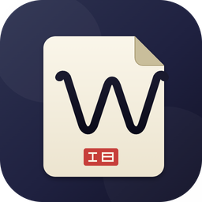

<p align="center">
  
</p>

<h1 align="center">无我笔记 Woo</h1>

<p align="center">
  <strong>本地优先 · 跨平台 Markdown 笔记应用</strong>
</p>

<p align="center">
  <a href="https://github.com/stophemo/Woo/releases"></a>
  <a href="LICENSE"></a>
  <a href="https://github.com/stophemo/Woo/releases"></a>
  <a href="https://github.com/stophemo/Woo/stargazers"></a>
</p>

<p align="center">
  <a href="https://woo-notes.vercel.app">🌐 官网</a> ·
  <a href="https://github.com/stophemo/Woo/releases/latest">📦 下载</a> ·
  <a href="#-开发">🛠️ 开发</a> ·
  <a href="#-路线图">🗺️ 路线图</a>
</p>

---

## ✨ 为什么选择 Woo

Woo（无我笔记）是一款本地优先的 Markdown 笔记应用。无需账号即可在本机离线写作；需要跨设备时，用任意 WebDAV 或同一 Wi-Fi 局域网同步到 macOS 与 Android。

> **v0.8.0**：新增本地 MCP 服务，Claude Code / Codex / Hermes / Pi 等本机 AI 工具可通过 Streamable HTTP 读写笔记，默认只读；设置菜单拆分为文件、编辑、查看、同步、MCP、帮助。

| | |
|---|---|
| 💾 **单库本地优先** | 无需登录/注册，启动直接打开本机 `woo.db`；正式文稿写入 SQLite，草稿留在本地，断网也能浏览和编辑 |
| ☁️ **WebDAV 同步** | 任意 WebDAV（坚果云/NAS/Nextcloud/自建），增量同步、最后写入胜出，不经过 Woo 中转服务器 |
| 📡 **局域网同步** | 桌面端内嵌 WebDAV；手机输入 6 位配对码自动发现并连接；同一 Wi-Fi 完全离线，与 WebDAV 二选一 |
| 🔤 **字体系统** | 界面统一使用内置「Noto Sans SC / Woo Sans」（真实 400–700 可变字重）；正文可选文楷（内置霞鹜文楷）、黑体、宋体、等宽；移动端 Aa 面板可调字号 |
| 📝 **桌面编辑** | Tiptap 所见即所得编辑器，支持 Markdown 输入与粘贴、表格、大纲和思维导图 |
| 📱 **移动编辑** | Android 层级目录 + 草稿箱；浮动格式条与 Aa 面板，自动保存，支持搜索、移动到目录、分享、回收站与版本回溯 |
| ⏱️ **版本历史** | 桌面端与 Android 均自动记录版本，也可手动建立和恢复正式文稿版本 |
| 📤 **文件与导出** | 桌面端可读写 Markdown / TXT 文件，并将文稿导出为 Markdown、纯文本或 PNG |
| 🔒 **应用内访问锁** | 可锁定文件夹或文稿；用于限制应用内查看，不等同于磁盘加密 |
| 🔌 **MCP 服务** | 桌面端可选开启；Claude Code、Codex、Hermes、Pi 等本机 AI 工具通过 Streamable HTTP 读写笔记，默认只读，写入需手动开启 |
| 🎨 **极简设计** | 温暖柔和的日间主题 + 护眼暗色主题 |

---

## 📦 下载

| 平台 | 下载 | 说明 |
|------|------|------|
| 🍎 macOS | [DMG (Apple Silicon)](https://github.com/stophemo/Woo/releases/latest) | 适用于 M 系列 Mac；签名与公证状态以对应 Release 说明为准 |
| 🤖 Android | [已签名 APK (ARM64)](https://github.com/stophemo/Woo/releases/latest) | 支持 `arm64-v8a`，安装时允许来自此来源的应用 |

> **macOS 用户**：安装前请阅读对应 Release 说明。若版本未完成 Apple 公证，首次启动请在 Finder 中右键 Woo.app 并选择“打开”，或前往“系统设置 → 隐私与安全”选择“仍要打开”。无需、也不要安装任何第三方根证书。

> **Windows 用户**：Windows 版暂停维护，暂不提供新的安装包与自动更新；已安装的旧版本仍可继续使用，但不再跟进新功能与修复。

---

## 🩺 排查问题

应用会把运行日志写入数据目录下的 `logs/woo.log`（超过 2MB 自动轮转为 `woo.log.1`）。同步、数据库打开等关键步骤均有记录，反馈问题时可只提供这个文件。

| 平台 | 日志路径 |
|------|----------|
| macOS | `~/Library/Application Support/Woo/logs/woo.log`（开发环境为 `woo-dev`） |
| Windows（旧版本） | `%APPDATA%\Woo\logs\woo.log`（开发环境为 `woo-dev`） |
| Android | 应用私有目录下的 `logs/woo.log` |

日志不会记录密码、令牌等敏感内容；WebDAV 失败时只会记录 HTTP 状态码与错误描述。

---

## 🚀 快速开始（用户）

1. 前往 [Releases](https://github.com/stophemo/Woo/releases/latest) 下载对应平台安装包
2. 安装并启动
3. 开始写作，文稿保存在本机 `woo.db`，无需登录
4. （可选）桌面端「设置 → WebDAV 同步」或移动端「我的 → WebDAV 同步」接入 WebDAV；同一 Wi-Fi 时可在桌面端「设置 → 局域网同步」启用，手机输入 6 位配对码自动连接

---

## 🛠️ 开发

### 技术栈

| 层 | 技术 |
|---|---|
| 桌面框架 | [Tauri v2](https://v2.tauri.app/) (Rust) |
| 前端 | Vue 3 + Pinia + Vite + TypeScript |
| 编辑器 | Tiptap (ProseMirror) |
| 数据库 | SQLite (rusqlite, bundled) |
| 同步 | 任意 WebDAV（含桌面端内置局域网 WebDAV） |
| 移动端 | Tauri Mobile (Android；iOS 计划中) |

### 项目结构

```
Woo/
├── src/                    # 桌面端前端 (Vue 3, ESM)
│   ├── stores/             # Pinia 状态管理 (workspace, sync, lock, theme…)
│   ├── services/           # IPC 客户端、更新、Markdown 转换与导出
│   ├── components/         # 桌面端 UI 组件 (layout/, settings/)
│   └── types/              # TypeScript 类型定义
├── src-mobile/             # 移动端前端 (Vue 3 + Vant UI)
│   ├── views/              # 移动端页面
│   └── router/             # 移动端路由
├── src-tauri/              # Rust 后端 (桌面端 + 移动端共用)
│   ├── src/
│   │   ├── commands/       # Tauri IPC 命令入口
│   │   ├── services/       # 业务逻辑 (folder, document, sync_engine…)
│   │   ├── db/             # SQLite 连接管理 + Schema 迁移
│   │   ├── supabase/       # 旧 Supabase 模块（运行时未启用）
│   │   └── models/         # 数据模型
│   └── gen/android/        # Android 项目骨架
├── landing/                # 官网落地页 (部署于 Vercel)
├── index.html              # 桌面端入口
├── index-mobile.html       # 移动端入口
├── vite.config.ts          # 桌面端 Vite 配置
└── vite.mobile.config.ts   # 移动端 Vite 配置
```

### 构建命令

```bash
# 桌面端
npm install                  # 安装前端依赖
npm run dev                  # 启动 Vite 开发服务器 (localhost:5173)
npm run tauri:dev            # Tauri 开发模式（自动启动 Vite + Rust 编译）
npm run build                # vue-tsc + vite build（仅前端）
npm run tauri:build          # 生产构建（含 Rust release 编译）

# 移动端
npm run dev:mobile           # 移动端 Vite 服务器 (localhost:5174)
npm run tauri:android:dev    # Android 开发模式（连接真机）
npm run tauri:android:build  # Android 生产构建
```

### IPC 约定

```
Vue 组件 → api.ts invoke() → Tauri Command (Rust) → Service → SQLite
                    ↓                                             ↓
              自动拆包 { ok, data }                          WebDAV (同步时)
```

- 所有 Rust 命令返回 `CommandResult<T> { ok, data?, message? }`
- 前端 `api.ts` 自动解包：`ok=false` 抛异常，原始值直接透传
- IPC 格式：`namespace:action`（如 `document:listByFolder`），参数为对象

> ⚠️ 禁止直接 `import { invoke }` —— 一律走 `services/api.ts`

### 数据库

应用始终使用单用户本地库 `woo.db`；启动不再恢复云端会话，也不会切换到 `woo-{user}.db`。旧版遗留的用户库文件仍保留在数据目录，但不会被自动打开。无文件夹草稿使用 `localStorage`，不进入 SQLite，也不参与 WebDAV 同步和版本历史。

| 表 | 说明 |
|---|---|
| `note_folder` | 文件夹树，`parent_id` 层级结构，软删除三态 |
| `note_document` | 文档，HTML `content`，标题从第一行自动提取 |
| `note_document_version` | 版本历史 (auto / manual / restore) |
| `sync_meta` | 键值存储 (last_sync_time, last_tombstone_pull) |

**软删除三态**：`deleted = 0` 正常 → `1` 回收站 → `2` 待硬删除（7 天清理窗口）

### 同步引擎

同步引擎在后台运行，也支持手动触发。本地保存或目录变更后会立即安排一轮同步，回到前台时也会补一轮；局域网约 10 秒、WebDAV 约 30 秒做一次兜底轮询。清单未变化时只发一个 HEAD 请求。

- **双向同步**：每轮同时拉取与推送；每条记录按 `update_time` 最新胜出，时间相同用内容哈希决定，删除通过墓碑向所有设备传播。
- **WebDAV 模式**：以 `manifest.json` 为提交点，按哈希只传变化的文稿/目录，墓碑保留 90 天；支持坚果云、NAS、Nextcloud、自建服务。
- **局域网模式**：桌面端内置 WebDAV 服务；桌面端设置显示 6 位配对码，手机在 WebDAV 页「电脑配对」输入后通过 UDP 广播自动发现 Mac，填入地址、令牌与目录并开始双向同步。手动地址仍可用，同一 Wi-Fi 不经过互联网。
- 版本历史、知识库分块与加锁密码只保留在本机，不参与同步。
- Supabase 登录/中转不参与运行时同步；仅保留旧数据兼容代码。
  详见 [docs/domestic-sync.md](docs/domestic-sync.md)。

### MCP 服务（桌面端）

桌面端可在「MCP → MCP 服务设置…」中开启仅本机访问的 Streamable HTTP MCP 服务，让 Claude Code、Codex、Hermes、Pi 等 AI 工具搜索、读取和写入笔记。默认只读，写入需单独开启；仅监听 `127.0.0.1`，使用 Bearer Token，并遵守锁定文稿、软删除和草稿边界。服务随 Woo 启停。

客户端配置、工具清单和故障排查见 [docs/mcp.md](docs/mcp.md)。

---

## 🗺️ 路线图

- [x] WebDAV 同步（含局域网）
- [x] 局域网 6 位配对码自动连接
- [ ] macOS 原生菜单 + 完整快捷键
- [ ] Homebrew Cask 分发
- [ ] iOS 支持 (Tauri Mobile)
- [x] 跨平台基础框架 (macOS + Android)
- [ ] 完成 macOS Developer ID 签名与 Apple 公证
- [x] 移动端响应式 UI 适配
- [ ] AI 辅助写作与 Agent 框架

---

## 📄 许可

[MIT](LICENSE) © 2025–2026 Woo Notes

---

<p align="center">
  <sub>🏗️ 用 Rust + Vue 3 构建 · 跑在 Tauri v2 上</sub>
</p>
